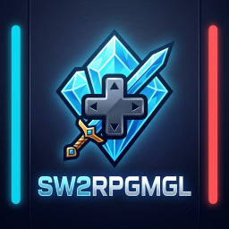

<p align="center">
  
</p>

<h1 align="center">SW2RPGMGL</h1>
<p align="center">
  <strong>Switch 2 RPG Maker Game Launcher</strong><br />
  Native Nintendo Switch 2 launcher &amp; runtime suite for <strong>RPG Maker MV</strong>, <strong>MZ</strong>, and <strong>VX Ace / VX / XP</strong> on <strong>kaiHEN</strong> (<code>libounce</code> + <code>OunceVK</code>).
</p>

> **Work in Progress:** This project is still under active development. Compatibility varies by game and plugin set — some games may experience graphical/audio glitches, lower performance, or crashes.

---

## Overview

**SW2RPGMGL** is a modular homebrew suite split into a lightweight instant-boot native launcher and drop-in engine runtimes:

| Component | File | Description |
|---|---|---|
| **Native Launcher** | `SW2RPGMGL.nro` | C++20 `libounce` 1280×720 game selector with system font (Latin + Japanese), icons, controller & touch support. |
| **RPG Maker MV Engine** | `engines/mv-engine-switch2.nro` | Switch 2 `nx.js` runtime with GPU acceleration, plugin shims, touchscreen support, and Quick Menu. |
| **RPG Maker MZ Engine** | `engines/mz-engine-switch2.nro` | Switch 2 `nx.js` runtime using hardware WebGL2 (OunceVK), WOFF/TTF font decoding, and Quick Menu. |
| **RPG Maker VX Ace / VX / XP** | `engines/mkxp-z-switch2.nro` | Experimental Switch 2 port of [GQster/mkxp-zSwitchPort](https://github.com/GQster/mkxp-zSwitchPort) (`mkxp-z`) with shared RTP support and `-` Quick Menu. |

> **Notes:**
> - `mkxp-z-switch2.nro` is an **experimental Switch 2 port** based on the Switch 1 version by **GQster** ([GQster/mkxp-zSwitchPort](https://github.com/GQster/mkxp-zSwitchPort)) and upstream [mkxp-z](https://github.com/mkxp-z/mkxp-z).
> - Original PC game folders are **never modified in place**. PC saves (`.rpgsave`, `.rmmzsave`, `Save*.rvdata2`) are compatible.

---

## Quick Start (SD Card Setup)

1. Copy `dist/sd-ready/switch/SW2RPGMGL/` to `sdmc:/switch/SW2RPGMGL/` on your Switch 2 SD card.
2. Drop your PC game folders inside `sdmc:/switch/SW2RPGMGL/games/`.
3. *(Optional, for VX Ace games)* Copy the RPG Maker VX Ace RTP (`Audio/`, `Fonts/`, `Graphics/`) into `sdmc:/switch/SW2RPGMGL/RPGVXAce/`.
4. Open **SW2RPGMGL** from **hbmenu** and pick a game.

### SD Card Folder Structure

```text
sdmc:/
└── switch/
    └── SW2RPGMGL/
        ├── SW2RPGMGL.nro                 # Native launcher (only tile shown in hbmenu)
        ├── engines/
        │   ├── mv-engine-switch2.nro     # RPG Maker MV runtime
        │   ├── mz-engine-switch2.nro     # RPG Maker MZ hardware WebGL2 runtime
        │   ├── mkxp-z-switch2.nro        # RPG Maker VX Ace / VX / XP runtime (experimental)
        │   └── nxjs.ini                  # nx.js runtime configuration
        ├── log/                          # Unified log directory (auto-created)
        │   ├── launcher.log
        │   ├── debug.log
        │   ├── mkxpz.log
        │   └── mkxpz_boot.log
        ├── RPGVXAce/                     # Optional: shared RPG Maker VX Ace RTP
        │   ├── Audio/
        │   ├── Fonts/
        │   └── Graphics/
        └── games/
            ├── <mv-game>/                # RPG Maker MV (www/ or flat web export)
            │   ├── save/                 # PC-compatible *.rpgsave files
            │   ├── mv-loader.json        # Optional per-game overrides
            │   └── www/
            ├── <mz-game>/                # RPG Maker MZ
            │   ├── index.html
            │   ├── js/
            │   └── save/                 # PC-compatible *.rmmzsave files
            └── <vxace-game>/             # RPG Maker VX Ace / VX / XP
                ├── Game.ini
                ├── Game.rgss3a           # Or unpacked Data/, Graphics/, Audio/
                └── Save*.rvdata2         # PC-compatible VX Ace saves
```

---

## Supported Engines

| Engine | Auto-Detected Layout | Saves | Notes |
|---|---|---|---|
| **RPG Maker MV** | `www/index.html` or flat `index.html` + `js/rpg_core.js` | `<game>/save/*.rpgsave` | Supports `.ogg`/`.rpgmvo` & `.m4a`/`.rpgmvm`, encrypted assets, custom fonts, and Canvas2D + auto-WebGL2 mode. |
| **RPG Maker MZ** | `index.html` + `js/rmmz_core.js` | `<game>/save/*.rmmzsave` | Hardware WebGL2 (GLES3 / OunceVK), WOFF 1.0 → TTF decoding, `.ogg`/`.ogg_` audio, lightweight Effekseer shim (`wasm = off`). |
| **RPG Maker VX Ace / VX / XP** | `Game.ini` / `.rgss3a` / `.rgss2a` / `.rgssad` | `<game>/Save*.rvdata2` | Experimental Switch 2 port of `mkxp-z`. Shared RTP auto-detected from `SW2RPGMGL/RPGVXAce/` or `games/RPGVXAce/`. |

---

## Controls

### Game Select Screen (`SW2RPGMGL.nro`)
| Input | Action |
|---|---|
| **D-Pad / Left Stick** | Navigate game list |
| **Touch Drag / Scrollbar Drag** | Smooth scroll through games |
| **L / R** | Page Up / Down (6 rows) |
| **A / Tap Selected Card** | Launch game |
| **X** | Rescan SD card for games |
| **+ (Plus)** | Exit to hbmenu |

### In-Game — RPG Maker MV & MZ
| Input | Action |
|---|---|
| **D-Pad / Left Stick** | Move / Navigate |
| **A / 1-Finger Tap** | Confirm (`ok` / Enter / Walk on map) |
| **B / 2-Finger Tap** | Cancel / Back / Menu (`cancel` / Esc) |
| **X** | Menu (`menu`) |
| **Y** | Dash / Shift (`shift`) |
| **L / R** | Page Up / Page Down (`pageup` / `pagedown`) |
| **ZL / ZR** | Plugin hotkeys (`tab` / `control`) |
| **L3 / R3** | Extra plugin hotkeys |
| **- (Minus)** | Open **SW2RPGMGL Quick Menu** (Display Mode, Texture Filter, FPS/RAM HUD, Skip Video, GC, Return to Game Select, Exit to hbmenu) |
| **Touchscreen** | Tap & drag mapped to the active game resolution |

### In-Game — RPG Maker VX Ace / VX / XP
| Input | Action |
|---|---|
| **D-Pad / Left Stick** | Move / Navigate |
| **A** | Confirm (`C`) |
| **B** | Cancel / Menu (`B`) |
| **X** | Menu / Action (`X`) |
| **Y** | Dash / Shift (`A`) |
| **L / R** | Page Up / Page Down (`L` / `R`) |
| **- (Minus)** | Open **SW2RPGMGL Quick Menu** (Resume, Performance HUD `SW2RPGMGL (VX) \| XX FPS`, Soft Reset, Return to Game Select, Exit to hbmenu) |

---

## Key Features

- **Universal MV/MZ Compatibility Layer (`loader/src/`):**
  - Automatic font discovery (`gamefont.css`, `.ttf`, `.otf`, `.woff` → SFNT TTF decoding via `pako`, and `FontLoad` plugin aliasing).
  - Multi-encoding `TextDecoder` shim (`utf-8`, `utf-16le`, `utf-16be`, `latin1`), NW.js (`nw.App`, `nw.Shell`, `fs`, `path`), `localStorage`, `MediaRecorder`, and `StereoPannerNode` shims.
  - V8-no-i18n Unicode property regex rewriting (`\p{...}`), top-level lexical hoisting for MZ script evaluation, and GLES3 FBO viewport/scissor re-projection.
  - Performance optimizations: selective dependency-indexed `Game_Map.refresh()`, compiled `Game_Interpreter` script cache, half-res GPU-upscaled `Lightmask`, and safe off-screen culling.
- **Optional Per-Game Config (`<game>/mv-loader.json`):**
  Every game works out of the box, or you can drop an optional `mv-loader.json` next to `www/` to override defaults:
  ```json
  {
    "title": "Custom Display Name",
    "skipPlugins": ["SomeBrokenPCPlugin.js"],
    "audioFormat": "auto",
    "displayMode": "fit",
    "filterMode": "auto",
    "fastMenu": true
  }
  ```
  `fastMenu` (MV, default `true`) keeps the map data and map sprites alive while a pause menu is open, so closing the menu doesn't reload the map. Set it to `false` if a plugin misbehaves after closing the menu.
- **FTP-Safe ASCII Helper (`make-ftp-safe.bat` / `scripts/make-ftp-safe.py`):**
  Some Switch FTP servers (`ftpd`) fail to transfer files with Japanese/non-ASCII filenames. Copying directly to the SD card on PC avoids this, or if you use FTP *(requires **Python 3** installed and on your `PATH`)*:
  1. Upload your original game folder to `sdmc:/switch/SW2RPGMGL/games/<Game>/` via FTP (skipping any non-ASCII files that fail).
  2. On PC, drag and drop your original game folder onto `make-ftp-safe.bat` (or run `python scripts/make-ftp-safe.py "C:\path\to\Game"`). This creates a `<Game>_ftp_patch` folder with pure-ASCII copies + `_jp_map.txt`.
  3. Upload everything **inside** `<Game>_ftp_patch` into `sdmc:/switch/SW2RPGMGL/games/<Game>/` on the Switch and **overwrite** any existing files if prompted. Both `mv-engine-switch2.nro` / `mz-engine-switch2.nro` and `mkxp-z-switch2.nro` read `_jp_map.txt` automatically.

---

## Building From Source

### Prerequisites
- **Windows:** Node.js (v18+) and Python 3 (for bundling/packing MV & MZ engines).
- **WSL2 (Ubuntu):** `ounce-devkit` / devkitPro (`aarch64-none-elf-g++`, `libounce`, `elf2nro`, `meson`, `ninja`) for compiling the native C++ launcher and `mkxp-z`.

### 1. Build MV & MZ Engines (Windows, ~5s)
Typechecks, runs the automated test suite, repacks `mv-engine-switch2.nro` and `mz-engine-switch2.nro`, and stages them into `dist/sd-ready/switch/SW2RPGMGL/engines/`:

```powershell
cd loader
node .\node_modules\typescript\bin\tsc --noEmit
node tools/test.mjs
node tools/build.mjs
```

### 2. Build Native Launcher (WSL2, ~2s)
Compiles `launcher/src/main.cpp` with `-mtp=soft`, verifies zero hard-TLS (`tpidr_el0`) instructions, embeds `loader/icon.jpg`, and stages `SW2RPGMGL.nro`:

```bash
bash scripts/wsl-build-launcher.sh
```

### 3. Build `mkxp-z` VX Ace / VX / XP Engine (WSL2)
Applies Switch 2 patches (`scripts/patch-mkxpz-switch2.py`) onto [GQster/mkxp-zSwitchPort](https://github.com/GQster/mkxp-zSwitchPort), compiles Ruby 3.1 + `mkxp-z` with OunceVK, checks soft-TLS safety, and stages `engines/mkxp-z-switch2.nro`:

```bash
bash scripts/wsl-build-mkxpz.sh
```

### 4. Rebuild Base `nx.js` C++ Runtime (Optional, WSL2)
```bash
bash scripts/wsl-rebuild-fast.sh
```

---

## Troubleshooting & Logs

All launcher and engine logs are written into `sdmc:/switch/SW2RPGMGL/log/`:

| Log File | Source |
|---|---|
| `log/launcher.log` | Native `SW2RPGMGL.nro` game scanner & handoff |
| `log/debug.log` | RPG Maker MV & MZ JS engine / plugin diagnostics |
| `log/mkxpz.log` & `log/mkxpz_boot.log` | RPG Maker VX Ace / VX / XP (`mkxp-z`) |
| `sdmc:/switch/nxjs-debug.log` | Low-level `nx.js` C++ / V8 / Skia / OunceVK output |

- **What is `sdmc:/hello-v8-mman.log` in the SD root?**
  It is a harmless debug log hardcoded in the prebuilt upstream `switch-v8` (`horizon_mman`) memory allocator inside `nxjs-switch2.nro`. It is overwritten on each MV/MZ launch and safe to ignore or delete.
- **Slow FPS in Live2D MV games?**
  Live2D CPU mesh deformation is heavy under V8 `jit = off`; disabling Live2D in-game (if the game offers a toggle) restores full 60 FPS.

---

## Credits

- [nx.js](https://github.com/TooTallNate/nx.js) — JavaScript runtime (Switch 2 `libounce` + `OunceVK` port)
- [mkxp-z](https://github.com/mkxp-z/mkxp-z) — RGSS / Ruby 3.1 engine
- [mkxp-zSwitchPort](https://github.com/GQster/mkxp-zSwitchPort) by **GQster** — Switch 1 `mkxp-z` port that `mkxp-z-switch2.nro` is experimentally ported from
- [kaiHEN](https://github.com/ouncebrew/kaihen) — Switch 2 homebrew environment ([ouncebrew](https://github.com/ouncebrew))
- [ounce-devkit](https://github.com/ouncebrew/ounce-devkit) — Switch 2 toolchain & `libounce` ([pkg.ouncebrew.org](https://pkg.ouncebrew.org))
- [OunceVK](https://github.com/ouncebrew/ouncevk) — Switch 2 Vulkan / EGL / OpenGL ES driver layer (NVK + Zink)

---

## License

This project is licensed under the **GNU General Public License v3.0** — see the [LICENSE](LICENSE) file for details.

Bundled/upstream runtimes retain their respective licenses (`mkxp-z`: GPL-2.0-or-later / GPL-3.0; `nx.js`: MIT).

